<div align="center">

# WGSL Rive Shaders

**A modular library of procedural WebGPU (WGSL) shaders and Luau Node scripts for [Rive](https://rive.app)'s `GPUCanvas`.**

[](https://www.w3.org/TR/WGSL/)
[](https://luau-lang.org/)
[](https://rive.app/)
[](./LICENSE)

</div>

---

## Overview

This repository houses procedural shader collections built for **Rive's Scripting + WebGPU (`GPUCanvas`)** pipeline. Every pattern is evaluated analytically per-pixel using Signed Distance Fields (SDFs) on a single full-screen procedural triangle (`pass:draw(3)`)—requiring **zero vertex buffers** while delivering crisp, resolution-independent `smoothstep` anti-aliasing and real-time animatable Inspector inputs.

### Collections

- **[`WGSL_Rive_Geometric_Patterns`](./WGSL_Rive_Geometric_Patterns)** — **16 procedural geometric pattern shaders** (`Dot`, `Square`, `Line`, `Grid`, `Cross`, `Ring`, `Checker`, `Triangle`, `Hex`, `Chevron`, `Radial`, `Star`, `Capsule`, `Hatch`, `Truchet`, and `Halftone`), complete with an all-in-one **[`WGSL_Rive_Geometric_Patterns.rev`](./WGSL_Rive_Geometric_Patterns/WGSL_Rive_Geometric_Patterns.rev)** Rive project file.

---

## Visual Gallery — `WGSL_Rive_Geometric_Patterns` (`4×4` Grid)

| 1. Dot Pattern | 2. Square Pattern | 3. Line Pattern | 4. Grid Pattern |
| :---: | :---: | :---: | :---: |
| <a href="./WGSL_Rive_Geometric_Patterns/wgsl_DotPattern_v001">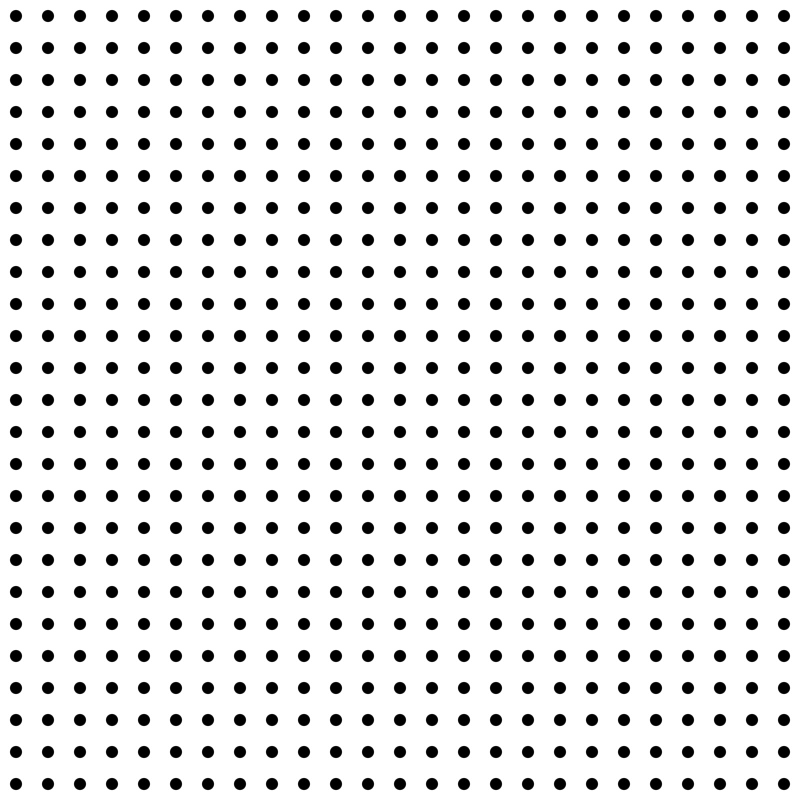</a> | <a href="./WGSL_Rive_Geometric_Patterns/wgsl_SquarePattern_v001">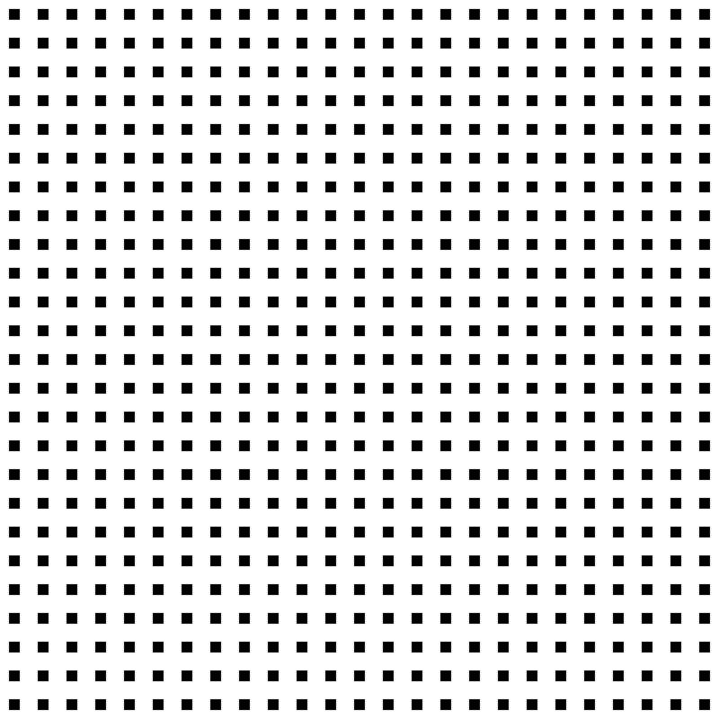</a> | <a href="./WGSL_Rive_Geometric_Patterns/wgsl_LinePattern_v001">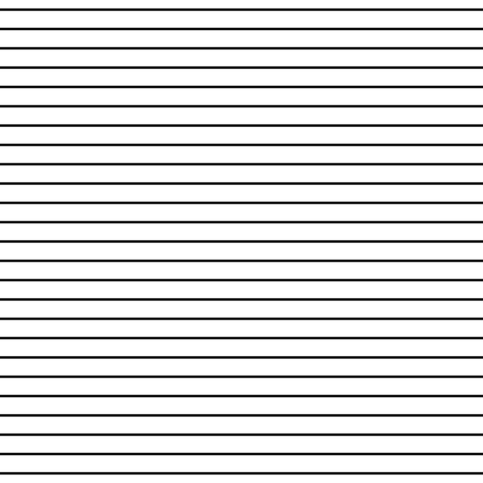</a> | <a href="./WGSL_Rive_Geometric_Patterns/wgsl_GridPattern_v001">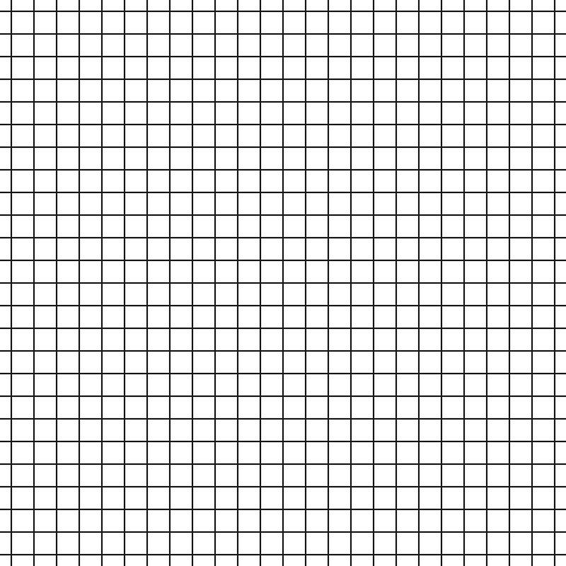</a> |
| [`DotPattern.luau`](./WGSL_Rive_Geometric_Patterns/wgsl_DotPattern_v001/DotPattern.luau)<br>[`DotPatternShader.wgsl`](./WGSL_Rive_Geometric_Patterns/wgsl_DotPattern_v001/DotPatternShader.wgsl) | [`SquarePattern.luau`](./WGSL_Rive_Geometric_Patterns/wgsl_SquarePattern_v001/SquarePattern.luau)<br>[`SquarePatternShader.wgsl`](./WGSL_Rive_Geometric_Patterns/wgsl_SquarePattern_v001/SquarePatternShader.wgsl) | [`LinePattern.luau`](./WGSL_Rive_Geometric_Patterns/wgsl_LinePattern_v001/LinePattern.luau)<br>[`LinePatternShader.wgsl`](./WGSL_Rive_Geometric_Patterns/wgsl_LinePattern_v001/LinePatternShader.wgsl) | [`GridPattern.luau`](./WGSL_Rive_Geometric_Patterns/wgsl_GridPattern_v001/GridPattern.luau)<br>[`GridPatternShader.wgsl`](./WGSL_Rive_Geometric_Patterns/wgsl_GridPattern_v001/GridPatternShader.wgsl) |

| 5. Cross Pattern | 6. Ring Pattern | 7. Checker Pattern | 8. Triangle Pattern |
| :---: | :---: | :---: | :---: |
| <a href="./WGSL_Rive_Geometric_Patterns/wgsl_CrossPattern_v001">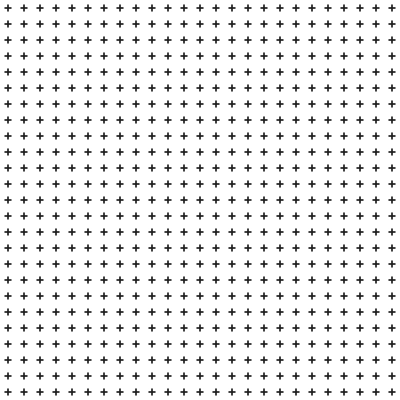</a> | <a href="./WGSL_Rive_Geometric_Patterns/wgsl_RingPattern_v001">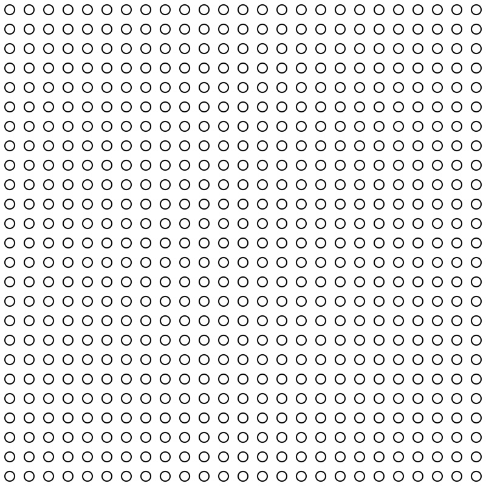</a> | <a href="./WGSL_Rive_Geometric_Patterns/wgsl_CheckerPattern_v001">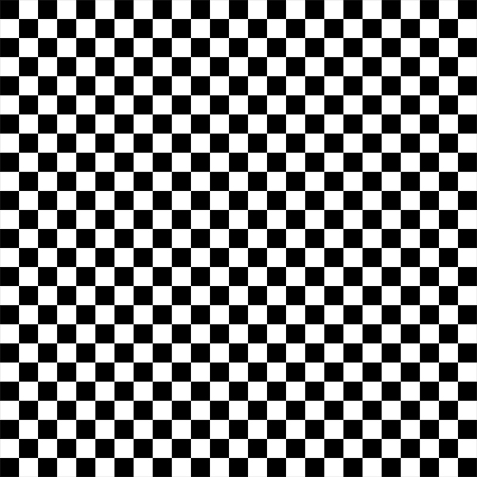</a> | <a href="./WGSL_Rive_Geometric_Patterns/wgsl_TrianglePattern_v001">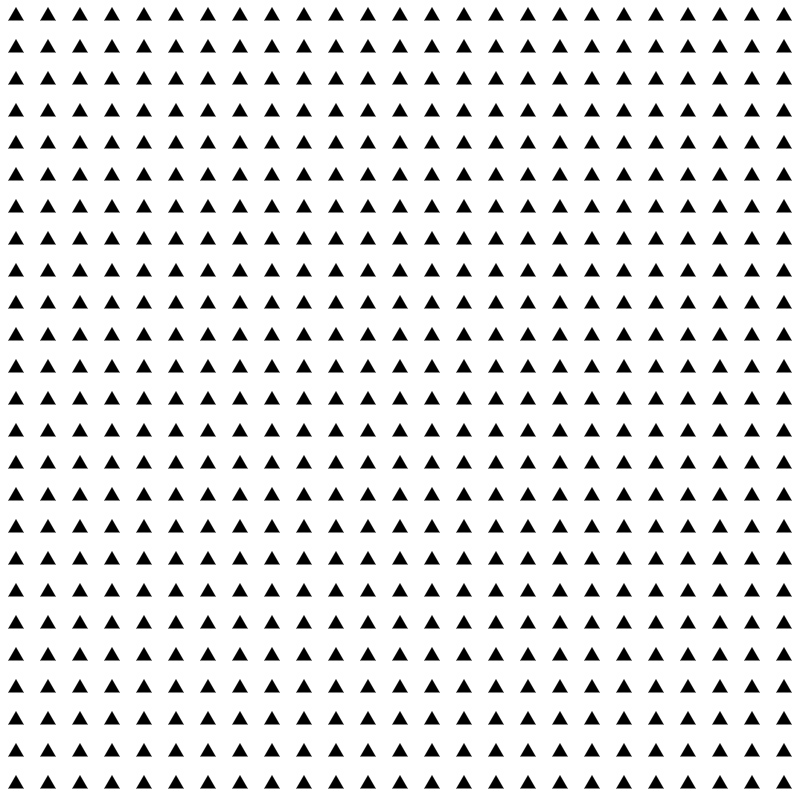</a> |
| [`CrossPattern.luau`](./WGSL_Rive_Geometric_Patterns/wgsl_CrossPattern_v001/CrossPattern.luau)<br>[`CrossPatternShader.wgsl`](./WGSL_Rive_Geometric_Patterns/wgsl_CrossPattern_v001/CrossPatternShader.wgsl) | [`RingPattern.luau`](./WGSL_Rive_Geometric_Patterns/wgsl_RingPattern_v001/RingPattern.luau)<br>[`RingPatternShader.wgsl`](./WGSL_Rive_Geometric_Patterns/wgsl_RingPattern_v001/RingPatternShader.wgsl) | [`CheckerPattern.luau`](./WGSL_Rive_Geometric_Patterns/wgsl_CheckerPattern_v001/CheckerPattern.luau)<br>[`CheckerPatternShader.wgsl`](./WGSL_Rive_Geometric_Patterns/wgsl_CheckerPattern_v001/CheckerPatternShader.wgsl) | [`TrianglePattern.luau`](./WGSL_Rive_Geometric_Patterns/wgsl_TrianglePattern_v001/TrianglePattern.luau)<br>[`TrianglePatternShader.wgsl`](./WGSL_Rive_Geometric_Patterns/wgsl_TrianglePattern_v001/TrianglePatternShader.wgsl) |

| 9. Hex Pattern | 10. Chevron Pattern | 11. Radial Pattern | 12. Star Pattern |
| :---: | :---: | :---: | :---: |
| <a href="./WGSL_Rive_Geometric_Patterns/wgsl_HexPattern_v001">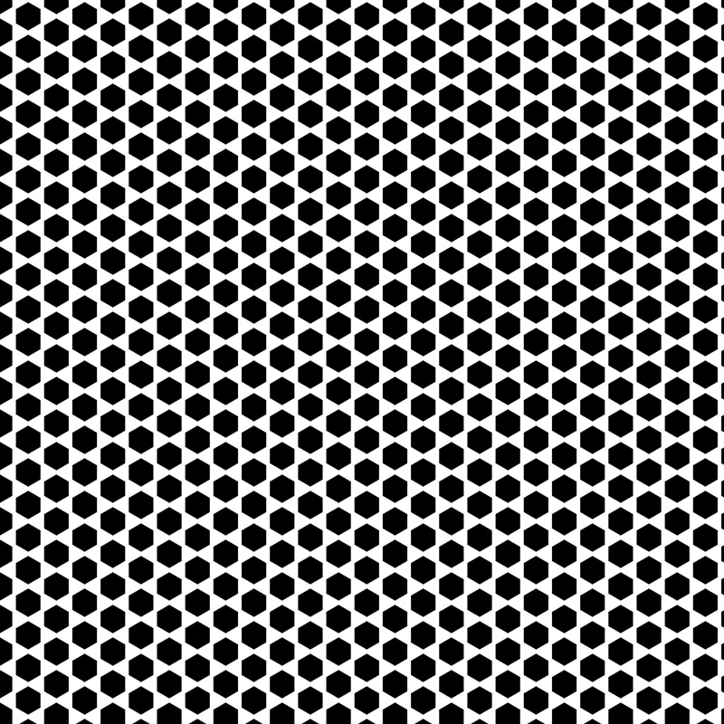</a> | <a href="./WGSL_Rive_Geometric_Patterns/wgsl_ChevronPattern_v001">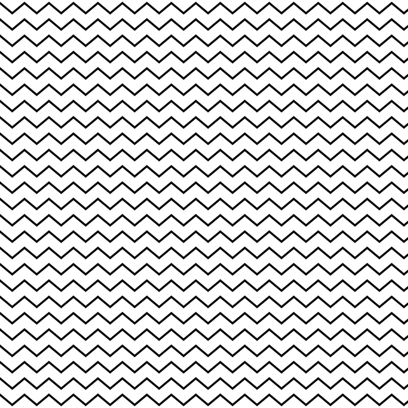</a> | <a href="./WGSL_Rive_Geometric_Patterns/wgsl_RadialPattern_v001">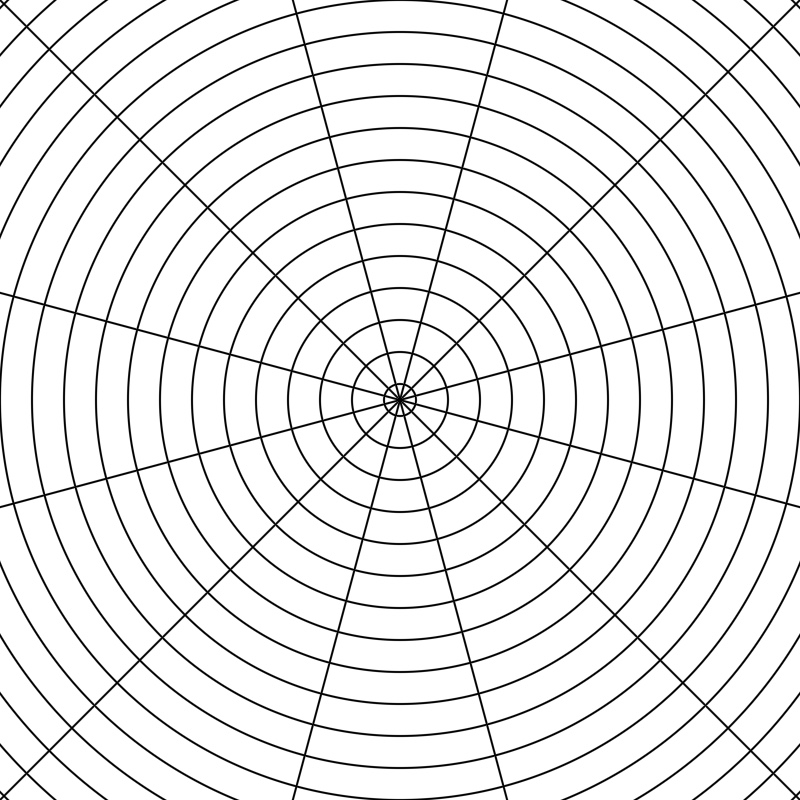</a> | <a href="./WGSL_Rive_Geometric_Patterns/wgsl_StarPattern_v001">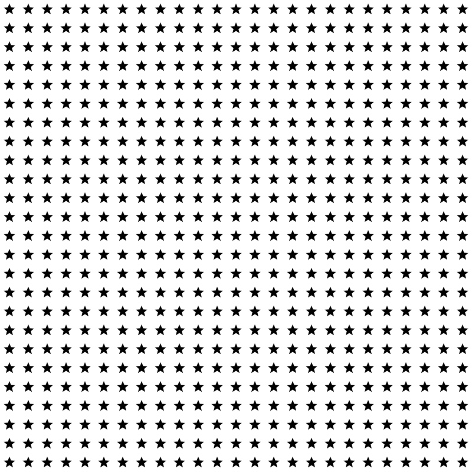</a> |
| [`HexPattern.luau`](./WGSL_Rive_Geometric_Patterns/wgsl_HexPattern_v001/HexPattern.luau)<br>[`HexPatternShader.wgsl`](./WGSL_Rive_Geometric_Patterns/wgsl_HexPattern_v001/HexPatternShader.wgsl) | [`ChevronPattern.luau`](./WGSL_Rive_Geometric_Patterns/wgsl_ChevronPattern_v001/ChevronPattern.luau)<br>[`ChevronPatternShader.wgsl`](./WGSL_Rive_Geometric_Patterns/wgsl_ChevronPattern_v001/ChevronPatternShader.wgsl) | [`RadialPattern.luau`](./WGSL_Rive_Geometric_Patterns/wgsl_RadialPattern_v001/RadialPattern.luau)<br>[`RadialPatternShader.wgsl`](./WGSL_Rive_Geometric_Patterns/wgsl_RadialPattern_v001/RadialPatternShader.wgsl) | [`StarPattern.luau`](./WGSL_Rive_Geometric_Patterns/wgsl_StarPattern_v001/StarPattern.luau)<br>[`StarPatternShader.wgsl`](./WGSL_Rive_Geometric_Patterns/wgsl_StarPattern_v001/StarPatternShader.wgsl) |

| 13. Capsule Pattern | 14. Hatch Pattern | 15. Truchet Pattern | 16. Halftone Pattern |
| :---: | :---: | :---: | :---: |
| <a href="./WGSL_Rive_Geometric_Patterns/wgsl_CapsulePattern_v001"></a> | <a href="./WGSL_Rive_Geometric_Patterns/wgsl_HatchPattern_v001">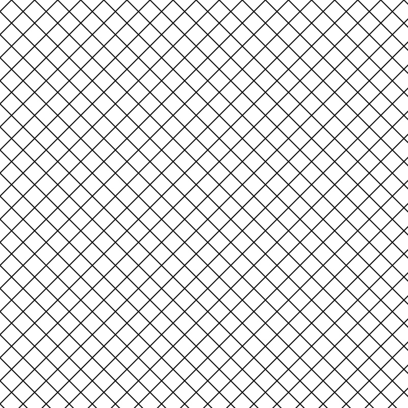</a> | <a href="./WGSL_Rive_Geometric_Patterns/wgsl_TruchetPattern_v001">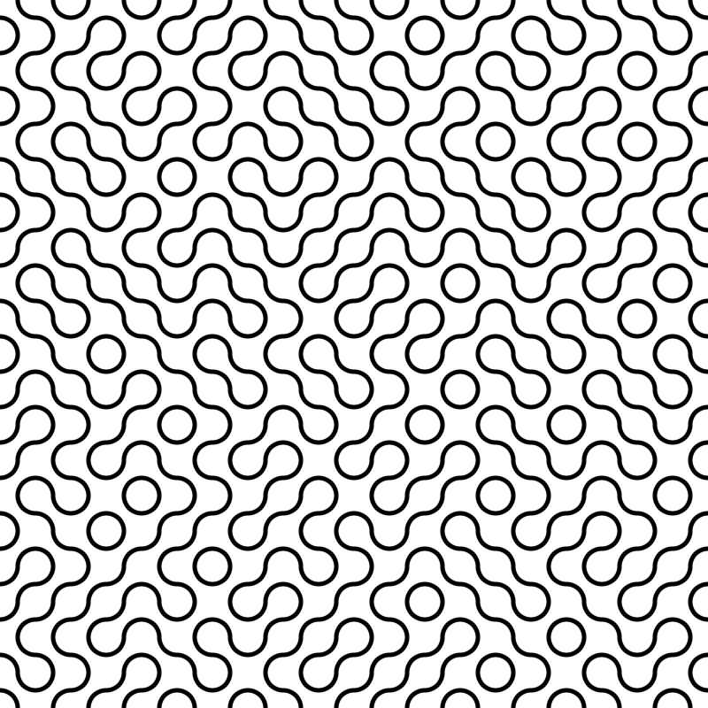</a> | <a href="./WGSL_Rive_Geometric_Patterns/wgsl_HalftonePattern_v001">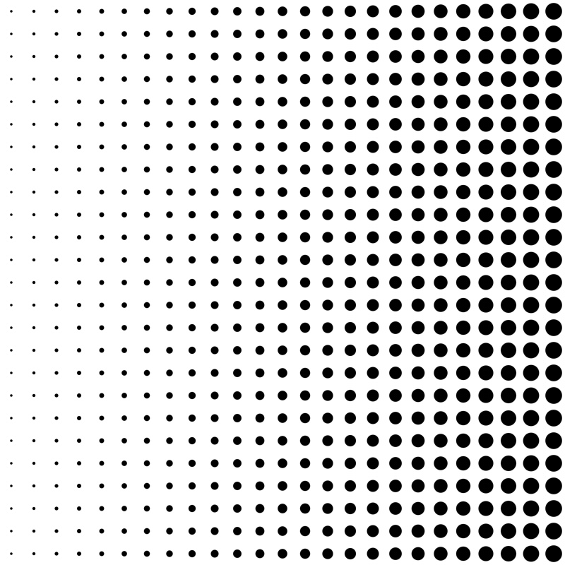</a> |
| [`CapsulePattern.luau`](./WGSL_Rive_Geometric_Patterns/wgsl_CapsulePattern_v001/CapsulePattern.luau)<br>[`CapsulePatternShader.wgsl`](./WGSL_Rive_Geometric_Patterns/wgsl_CapsulePattern_v001/CapsulePatternShader.wgsl) | [`HatchPattern.luau`](./WGSL_Rive_Geometric_Patterns/wgsl_HatchPattern_v001/HatchPattern.luau)<br>[`HatchPatternShader.wgsl`](./WGSL_Rive_Geometric_Patterns/wgsl_HatchPattern_v001/HatchPatternShader.wgsl) | [`TruchetPattern.luau`](./WGSL_Rive_Geometric_Patterns/wgsl_TruchetPattern_v001/TruchetPattern.luau)<br>[`TruchetPatternShader.wgsl`](./WGSL_Rive_Geometric_Patterns/wgsl_TruchetPattern_v001/TruchetPatternShader.wgsl) | [`HalftonePattern.luau`](./WGSL_Rive_Geometric_Patterns/wgsl_HalftonePattern_v001/HalftonePattern.luau)<br>[`HalftonePatternShader.wgsl`](./WGSL_Rive_Geometric_Patterns/wgsl_HalftonePattern_v001/HalftonePatternShader.wgsl) |

---

## Quick Start — How to Use in Rive

### Method 1: Open the Master `.rev` File (Recommended)
1. Download **[`WGSL_Rive_Geometric_Patterns.rev`](./WGSL_Rive_Geometric_Patterns/WGSL_Rive_Geometric_Patterns.rev)** and import/open it in the Rive Editor.
2. You will see a `4×4` grid of `800×800` Artboards and all 16 `wgsl_<PatternName>_v001` folders in the **Assets / Scripts** panel.
3. **To use a pattern in another Rive file**: Copy (`Cmd/Ctrl + C`) the `ScriptedDrawable` node from any Artboard and paste (`Cmd/Ctrl + V`) it into your target Rive project—Rive automatically brings over both the Luau Node script and its paired WGSL shader!

### Method 2: Import Individual Scripts from Disk
Each pattern folder (`wgsl_<PatternName>_v001/`) contains two code files:
- `<PatternName>Shader.wgsl` — The WebGPU vertex + fragment shader
- `<PatternName>.luau` — The Rive `Node<T>` script that exposes Inspector inputs and manages the `GPUCanvas`

To bring a single pattern into a fresh Rive file:
1. **Create the WGSL Shader first**:
   - In Rive's **Assets / Scripts** panel, click **`+` → New Shader (WGSL)**.
   - Name it **exactly** `<PatternName>Shader` (e.g., `DotPatternShader` — must match the string passed to `context:shader('<PatternName>Shader')` in the `.luau` script).
   - Paste the contents of `<PatternName>Shader.wgsl`.
2. **Create the Luau Node Script**:
   - Click **`+` → New Script (Node)**.
   - Name it `<PatternName>` (e.g., `DotPattern`) and paste the contents of `<PatternName>.luau`.
3. **Attach to an Artboard**:
   - Drag the `<PatternName>` Node script from the Assets panel onto your Artboard.
   - Select the node in the Hierarchy to adjust its live parameters in the **Inspector**, or bind its inputs to a **State Machine / ViewModel**!

### Pro-Tips for Rive Workflows
- **Brick & Isometric Grids (`stagger`)**: All cell-based patterns include a `stagger` parameter (`0` to `100` percentage). Set `stagger = 50` to shift odd rows by 50% of `spacingX` for honeycomb/brick layouts, or animate `stagger` continuously from `0` to `100` for sliding row transitions.
- **Vector Clipping Masks**: Because each Node renders a transparent-background `GPUCanvas` (`srcOver`), you can place any Rive vector path, custom typography, or animated shape on top of it and apply a **Rive Clip** to fill complex vector artwork with live shaders.

---

## Parameter Reference Catalog

All patterns share `canvasWidth` (default `800`), `canvasHeight` (default `800`), and a `<pattern>Color` input (default opaque black `rgba(0, 0, 0, 255)`).

| # | Pattern | Folder | Custom Inspector Inputs & Defaults | Creative Notes |
| :-: | :--- | :--- | :--- | :--- |
| **1** | **Dot Pattern** | [`wgsl_DotPattern_v001`](./WGSL_Rive_Geometric_Patterns/wgsl_DotPattern_v001) | `radius` (`6`), `spacingX` (`32`), `spacingY` (`32`), `stagger` (`0`) | Set `stagger = 50` for a classic polka-dot honeycomb layout. |
| **2** | **Square Pattern** | [`wgsl_SquarePattern_v001`](./WGSL_Rive_Geometric_Patterns/wgsl_SquarePattern_v001) | `sizeX` (`12`), `sizeY` (`12`), `cornerRadius` (`0`), `rotation` (`0°`), `spacingX` (`32`), `spacingY` (`32`), `stagger` (`0`) | Set `rotation = 45` for diamonds, or increase `cornerRadius` for squircles/pills. |
| **3** | **Line Pattern** | [`wgsl_LinePattern_v001`](./WGSL_Rive_Geometric_Patterns/wgsl_LinePattern_v001) | `thickness` (`4`), `spacing` (`32`), `angle` (`0°`), `offset` (`0`) | Animate `offset` from `0` to `spacing` for infinite scrolling scanlines/stripes. |
| **4** | **Grid Pattern** | [`wgsl_GridPattern_v001`](./WGSL_Rive_Geometric_Patterns/wgsl_GridPattern_v001) | `thicknessX` (`2`), `thicknessY` (`2`), `spacingX` (`32`), `spacingY` (`32`), `offsetX` (`0`), `offsetY` (`0`) | Independent X and Y line weights for blueprint and technical graph paper grids. |
| **5** | **Cross Pattern** | [`wgsl_CrossPattern_v001`](./WGSL_Rive_Geometric_Patterns/wgsl_CrossPattern_v001) | `length` (`12`), `thickness` (`3`), `rotation` (`0°`), `spacingX` (`32`), `spacingY` (`32`), `stagger` (`0`) | Union of two orthogonal SDF boxes. Set `rotation = 45` for an `×` reticle grid. |
| **6** | **Ring Pattern** | [`wgsl_RingPattern_v001`](./WGSL_Rive_Geometric_Patterns/wgsl_RingPattern_v001) | `radius` (`8`), `thickness` (`2`), `spacingX` (`32`), `spacingY` (`32`), `stagger` (`0`) | When `radius > spacing / 2`, rings overlap into interlocking chainmail/seigaiha waves. |
| **7** | **Checker Pattern** | [`wgsl_CheckerPattern_v001`](./WGSL_Rive_Geometric_Patterns/wgsl_CheckerPattern_v001) | `spacingX` (`32`), `spacingY` (`32`), `angle` (`0°`) | Analytical signed-product SDF checkerboard with crisp anti-aliased corners at any angle. |
| **8** | **Triangle Pattern** | [`wgsl_TrianglePattern_v001`](./WGSL_Rive_Geometric_Patterns/wgsl_TrianglePattern_v001) | `radius` (`9`), `cornerRadius` (`0`), `rotation` (`0°`), `spacingX` (`32`), `spacingY` (`32`), `stagger` (`0`) | Equilateral triangle SDF with local rotation and rounded corner support. |
| **9** | **Hex Pattern** | [`wgsl_HexPattern_v001`](./WGSL_Rive_Geometric_Patterns/wgsl_HexPattern_v001) | `cellSize` (`36`), `gap` (`4`), `cornerRadius` (`0`), `rotation` (`0°`) | True dual-lattice isometric honeycomb tiling with adjustable grout `gap` and corner rounding. |
| **10** | **Chevron Pattern** | [`wgsl_ChevronPattern_v001`](./WGSL_Rive_Geometric_Patterns/wgsl_ChevronPattern_v001) | `thickness` (`4`), `spacing` (`32`), `amplitude` (`10`), `wavelength` (`48`), `sharpness` (`1`), `angle` (`0°`), `offset` (`0`) | Morphs smoothly between a sine wave (`sharpness = 0`) and sharp zigzag (`sharpness = 1`) with slope-normalized stroke thickness. |
| **11** | **Radial Pattern** | [`wgsl_RadialPattern_v001`](./WGSL_Rive_Geometric_Patterns/wgsl_RadialPattern_v001) | `centerX` (`400`), `centerY` (`400`), `ringSpacing` (`32`), `ringThickness` (`2`), `rayCount` (`12`), `rayThickness` (`2`), `rotation` (`0°`) | Polar coordinate grid combining concentric rings and angular sunburst spokes. Set `ringThickness = 0` or `rayThickness = 0` to isolate either. |
| **12** | **Star Pattern** | [`wgsl_StarPattern_v001`](./WGSL_Rive_Geometric_Patterns/wgsl_StarPattern_v001) | `points` (`5`), `outerRadius` (`10`), `innerRadius` (`4.5`), `cornerRadius` (`0`), `rotation` (`0°`), `spacingX` (`32`), `spacingY` (`32`), `stagger` (`0`) | N-pointed star (`points = 4` for 4-point sparkles, `5` for classic stars, `6+` for bursts) with upright `0°` alignment. |
| **13** | **Capsule Pattern** | [`wgsl_CapsulePattern_v001`](./WGSL_Rive_Geometric_Patterns/wgsl_CapsulePattern_v001) | `length` (`12`), `radius` (`4`), `rotation` (`45°`), `spacingX` (`32`), `spacingY` (`32`), `stagger` (`0`) | Rounded pill/dash segments for Memphis-style confetti or raindrop textures. |
| **14** | **Hatch Pattern** | [`wgsl_HatchPattern_v001`](./WGSL_Rive_Geometric_Patterns/wgsl_HatchPattern_v001) | `thicknessA` (`2`), `thicknessB` (`2`), `spacingA` (`32`), `spacingB` (`32`), `angleA` (`45°`), `angleB` (`-45°`), `offsetA` (`0`), `offsetB` (`0`) | Dual independent line families—create `±45°` diamond meshes, `±30°` isometric grids, or engraving cross-hatching. |
| **15** | **Truchet Pattern** | [`wgsl_TruchetPattern_v001`](./WGSL_Rive_Geometric_Patterns/wgsl_TruchetPattern_v001) | `cellSize` (`40`), `thickness` (`5`), `seed` (`1`), `rotation` (`0°`) | Quarter-circle Smith Truchet tiles driven by a deterministic 2D hash (`seed`) to form continuous organic mazes. |
| **16** | **Halftone Pattern** | [`wgsl_HalftonePattern_v001`](./WGSL_Rive_Geometric_Patterns/wgsl_HalftonePattern_v001) | `minRadius` (`1.5`), `maxRadius` (`12`), `angle` (`0°`), `spacingX` (`32`), `spacingY` (`32`), `stagger` (`0`) | Directional comic/print halftone screen where dot radius interpolates across the canvas along `angle`. |

---

## Architecture & Shader Authoring Notes

If you are extending this library or authoring new WGSL shaders for Rive, keep these four architectural conventions in mind:

1. **Full-Screen Procedural Triangle (`pass:draw(3)`)**:
   Every shader uses a 3-vertex procedural triangle (`(-1, -1)`, `(3, -1)`, `(-1, 3)`) indexed via `@builtin(vertex_index) vid: u32`. This covers the entire viewport in a single draw call without allocating or binding any vertex buffers (`vertexLayout = {}`).
2. **WebGPU `16-Byte` Uniform Buffer Alignment**:
   In WGSL uniform structs, `vec4<f32>` fields must be aligned to 16-byte boundaries:
   - Shaders with **1–4 scalar `f32` inputs** use a **32-byte UBO** (`f32` inputs at bytes `0..12`, `vec4<f32>` color at byte `16`).
   - Shaders with **5–8 scalar `f32` inputs** use a **48-byte UBO** (`f32` inputs + padding at bytes `0..28`, `vec4<f32>` color at byte `32`).
3. **Euclidean Modulo for Seamless Tiling**:
   WGSL's `%` operator is truncated division and yields negative values when coordinates are shifted by `offset` or `stagger`. Always use floor-based Euclidean modulo so patterns tile seamlessly across negative coordinates:
   ```wgsl
   let cell_pos = (p - floor(p / spacing) * spacing) - spacing * 0.5;
   ```
4. **Premultiplied Alpha Output (`rgba8unorm`)**:
   Rive's `GPUCanvas` composites using premultiplied alpha. Every fragment shader anti-aliases its SDF distance `dist` over a `1.5px` window (`smoothstep(-0.75, 0.75, dist)`) and outputs premultiplied RGBA:
   ```wgsl
   let alpha = (1.0 - smoothstep(-0.75, 0.75, dist)) * params.color.a;
   return vec4<f32>(params.color.rgb * alpha, alpha);
   ```
